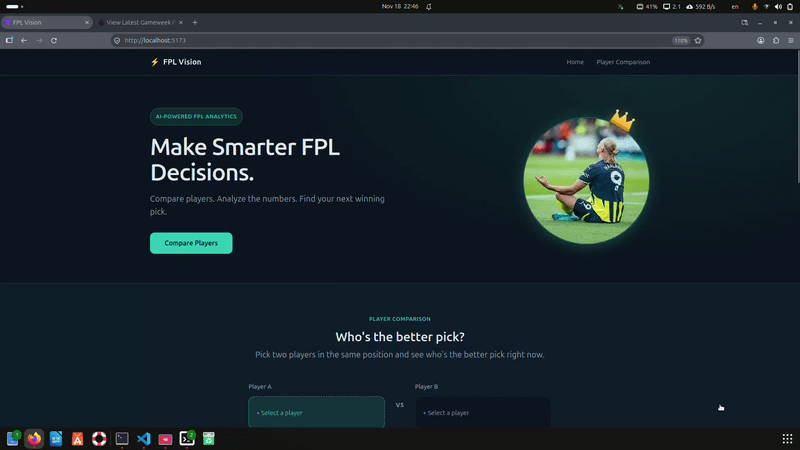
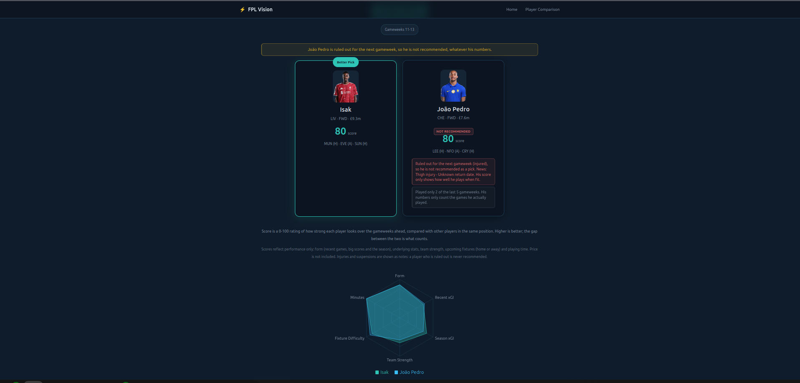
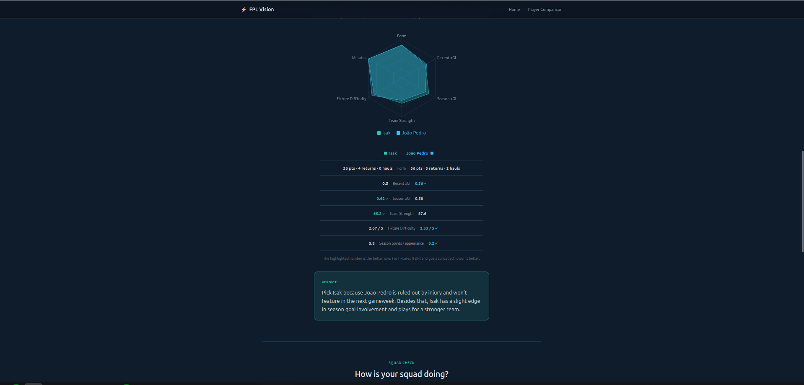
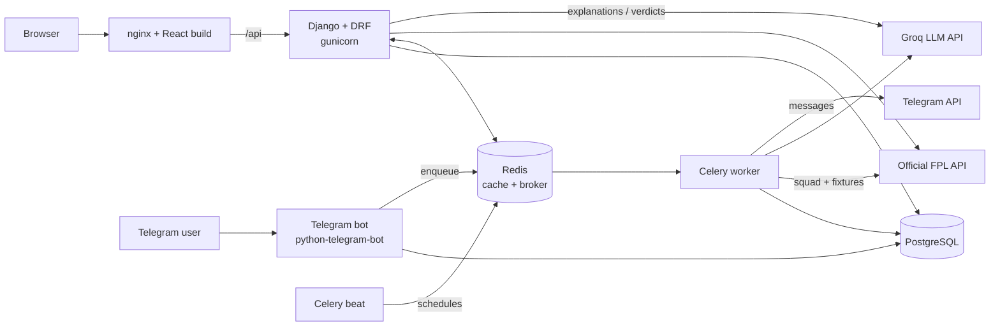

# FPL AI Co-Manager

An AI-assisted Fantasy Premier League co-manager: a **React website** for deep player analysis and a **Telegram bot** for quick advice and deadline reminders, both powered by one **Django REST** backend.

It combines live FPL data, a statistical rating engine, and an LLM that explains decisions in plain language (English and Persian).



| Player Comparison | LLM Verdict |
|---|---|
|  |  |

---

## What it does

**Website**
- **Compare players** side by side with a radar chart, form, fixtures and an AI verdict.
- **Squad check**: paste your FPL team and get a flagged list of players to review (minutes risk, slumps, fixture outlook), plus **predicted points** for every player of the squad for the next gameweek, shown on a pitch in the squad's formation (e.g. 3-5-2) with the bench below. Each player has a likely range (10th-90th percentile), the team gets a total, and a **recommended captain** is highlighted with a vice-captain. The captain is a fit, likely-to-play midfielder or forward from the XI, ranked by predicted points with a strong bonus for premium players (price and ownership percentile; constants `PRIME_BONUS` etc. in `expected_points.py`). No LLM involved: it is a statistical model (minutes, team goal model, per-90 rates, exact scoring distributions; double and blank gameweeks handled). FPL's own `ep_next` is shown beside it only for comparison.
- JWT-based accounts, with an FPL team linked to each profile.

**Telegram bot** (`/start`, `/setteamid`, `/myteam`, `/prediction`, `/differentials`, `/performance`, `/fixtures`, `/language`, `/status`, `/help`)
- Captain and transfer suggestions for your own squad, including hit cost and "hold" advice.
- Low-ownership **differential** picks with a one-line reason each.
- Per-gameweek **performance** summaries.
- **Deadline reminder** within 24 hours of the deadline, and a **weekly squad health check** every Friday at 20:00.
- Fully bilingual: English and Persian (with RTL handling).

**Under the hood**
- FPL data synced on a schedule (bootstrap, fixtures, live stats every 5 minutes).
- Predictions are stored and later **evaluated against real results** once a gameweek finishes.
- `python manage.py backtest_xp` replays the expected-points model on finished gameweeks (using only earlier data) and reports the average error, the bias, how often the real score fell inside the shown range (should be near 80%) and the comparison with a naive "last 5 games" guess. Run `python manage.py backfill_live_stats` once after deploying so older gameweeks get the new saves / bonus / cards fields. Next season the model can use last season's data as a prior through `Dataset.priors` (see `expected_points.py`).
- A **backtest** tool (`apps/fpl_data/squad_backtest.py`) checks whether the squad-check rules actually separate under- and over-performers, and warns about its own statistical limits.

---

## Why it's interesting

- **Statistics first, LLM second.** Ratings come from a deterministic engine in `compare_engine.py` (shrunk per-minute rates, z-score and percentile ratings, fixture and team-strength adjustments). The LLM (Groq, `openai/gpt-oss` models) explains and decides between options. It does not invent the numbers.
- **Two front doors, one backend.** The bot and website share the same services, so a fix lands in both.
- **Built to run unattended.** Scheduled jobs, retries, idempotent reminders and rate limits (see [Production notes](#production-notes)).

---

## Architecture



| Service | Role |
|---|---|
| `backend` | Django REST API (auth, players, comparison, squad insights) |
| `bot` | Telegram bot process (`manage.py runbot`) |
| `celery-worker` / `celery-beat` | Data syncs, predictions, reminders, weekly checks |
| `db` / `redis` | PostgreSQL 17, Redis 7 (Redis db 0 = Celery, db 1 = cache and throttle counters) |
| `web` (prod) | nginx serving the React build and proxying `/api/` |

**Code map**

```
backend/apps/
  fpl_data/       FPL sync, rating engine, compare + squad insights, throttles
  predictions/    AI predictions, caching, evaluation vs real results
  notifications/  Telegram bot, reminder tasks, translations (en/fa)
  accounts/       users, JWT auth, FPL manager profiles
frontend/src/     React 19 + Vite + Recharts
```

---

## Tech stack

Django 5.2 LTS · Django REST Framework · PostgreSQL · Celery + Redis · python-telegram-bot · Groq API · React 19 · Vite · Recharts · Docker Compose · gunicorn · nginx

---

## Quick start (Docker)

```bash
git clone https://github.com/Mohhamadaminn/fpl-ai-comanager.git
cd fpl-ai-comanager
# create .env in the project root (see Configuration below)
docker compose up --build
```

Then open the API at `http://localhost:8000`. Run the frontend with `npm install && npm run dev` inside `frontend/` (`http://localhost:5173`).

The dev compose file routes outbound traffic through a proxy by default (`HTTP_PROXY` etc.). Override those variables if you don't need one.

<details>
<summary>Running without Docker</summary>

```bash
cd backend
python -m venv .venv && source .venv/bin/activate
pip install -r requirements/dev.txt
python manage.py migrate
python manage.py runserver        # API
python manage.py runbot           # Telegram bot (separate terminal)
celery -A config worker -l info   # worker (separate terminal)
celery -A config beat -l info     # scheduler (separate terminal)
```
</details>

## Configuration

Required:

| Variable | Purpose |
|---|---|
| `SECRET_KEY` | Django secret |
| `DB_NAME`, `DB_USER`, `DB_PASSWORD` | PostgreSQL |
| `GROQ_API_KEY` | LLM access |
| `TELEGRAM_BOT_TOKEN` | Bot token from BotFather |
| `CELERY_BROKER_URL`, `CELERY_RESULT_BACKEND` | Redis URLs |
| `ALLOWED_HOSTS`, `CORS_ALLOWED_ORIGINS`, `CSRF_TRUSTED_ORIGINS` | Host and origin allow-lists |

Optional tuning (all have defaults):

| Variable | Default | Purpose |
|---|---|---|
| `LLM_THROTTLE_BURST` / `LLM_THROTTLE_DAILY` | `10/minute` / `200/day` | Per-IP limits on LLM-backed endpoints |
| `NUM_PROXIES` | `1` | Trusted proxy hops for client-IP detection |
| `GROQ_TIMEOUT_SECONDS`, `GROQ_MAX_RETRIES` | `20`, `1` | LLM call limits |
| `WEB_CONCURRENCY`, `GUNICORN_THREADS`, `GUNICORN_TIMEOUT` | `3`, `4`, `90` | gunicorn sizing |
| `BOT_CONCURRENT_UPDATES` | `8` | Telegram updates handled in parallel |
| `CELERY_TASK_SOFT_TIME_LIMIT`, `CELERY_TASK_TIME_LIMIT` | `600`, `660` | Celery limits (seconds) |
| `REDIS_CACHE_URL` | broker URL, db 1 | Cache and throttle store |
| `USE_HTTPS` | `False` | Enables HTTPS-related security settings |

---

## Production notes

`docker-compose.prod.yml` runs gunicorn (threaded workers) behind nginx; the backend port is not published to the host.

- **Rate limiting:** the two LLM-backed endpoints are throttled per IP with counters in Redis. nginx overwrites `X-Forwarded-For`, so clients cannot spoof their way around the limit.
- **Timeouts everywhere:** Groq, FPL API and nginx upstream calls all have explicit timeouts, so one slow dependency can't tie up workers.
- **Retries:** FPL sync tasks retry with exponential backoff; user-triggered tasks retry and then tell the user if they still fail.
- **Idempotent reminders:** the deadline reminder uses a lock and per-user "already sent" markers, so overlapping runs or retries never message anyone twice.
- **Bot concurrency:** the bot handles multiple updates in parallel and recycles stale database connections.

Not covered yet: automated database backups, admin-panel network restriction and TLS termination.

---

## Testing

```bash
cd backend
python manage.py test apps.fpl_data.test_throttling apps.fpl_data.test_reliability apps.notifications.test_reliability
```

These need no database. The rest of the suite uses PostgreSQL, so set the `DB_*` variables first.

---

## Known limitations

- Predictions are advisory and not guaranteed to be right; the evaluation job records how they actually did.
- No global spending cap on LLM calls yet. Per-IP throttling is the only guard.
- Data comes from the unofficial public FPL API, which can change without notice.

## Roadmap

- Scheduled database backups and a restore drill
- TLS and admin lockdown once hosting is chosen
- Wider test coverage for the prediction pipeline

---

## Author

**Mohamadamin Alizadeh**, backend developer (Django/DRF, PostgreSQL, Docker).
GitHub: [@Mohhamadaminn](https://github.com/Mohhamadaminn)

## License

Personal portfolio project. All rights reserved unless a license file says otherwise. Not affiliated with the Premier League or Fantasy Premier League.